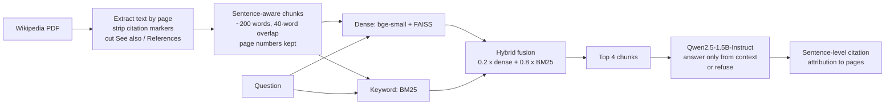
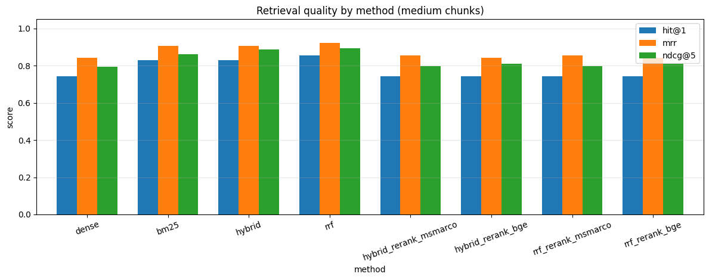
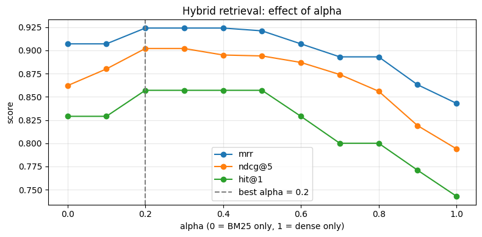
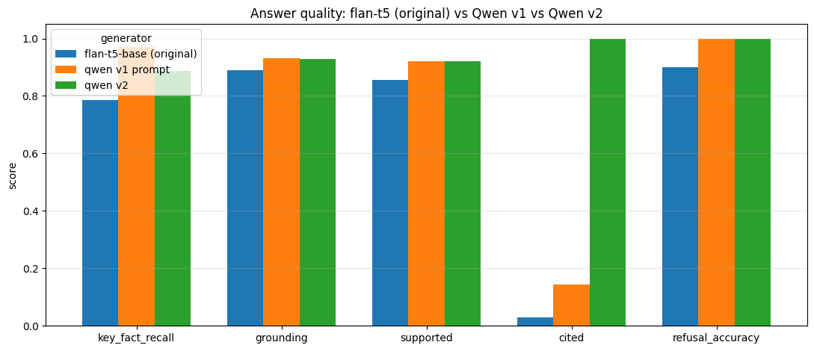

# RAG over Wikipedia: Hybrid Retrieval, Reranking and Grounded Answers

A Retrieval-Augmented Generation (RAG) pipeline that answers questions about the Wikipedia article **Machine learning**, cites the pages its answers come from, and refuses questions the article cannot answer. Every design choice is **measured** on a labelled evaluation set: retrieval method, fusion weight, chunk size, reranker, generator and prompt.

### Key results

| | Result |
|---|---|
| **Retrieval** (hybrid BM25 + dense, tuned weight) | **85.7% Hit@1**, **0.924 MRR**, 0.902 nDCG@5, 96.9% Recall@5 |
| vs dense-only retrieval | +11.4 points Hit@1 (74.3% → 85.7%) |
| **Answers** (Qwen2.5-1.5B vs original flan-t5-base) | key facts correct **97.1% vs 78.6%** |
| Out-of-scope questions refused | **10/10** (flan-t5: 9/10), no wrong refusals on in-scope questions |
| Answers with page citations | **100%** with sentence-level attribution (model's own citations alone: 14–20%) |

*Evaluation set: 35 labelled in-scope questions plus 10 out-of-scope questions. See [Limitations](#limitations).*

**Demo app:** a Streamlit app (`app.py`) lets you ask questions about the article, or about your own PDF, and shows each answer with its page citations and the retrieved passages. See [Run the app](#run-the-app).

---

## Pipeline



1. **Ingestion:** the article is downloaded as a PDF and extracted page by page with PyMuPDF. Citation markers like `[12]` are removed, and everything from *See also* onwards is cut so link lists never come back as answers. Result: 24 pages, 9,917 words.
2. **Chunking:** sentence-aware chunks that can cross page breaks, so no sentence is cut in half, while keeping `page_start` and `page_end` for citations.
3. **Retrieval:** dense search (`BAAI/bge-small-en-v1.5` + FAISS) and BM25 keyword search, combined by min-max-normalised weighted fusion or Reciprocal Rank Fusion. Two cross-encoder rerankers were tested.
4. **Generation:** `Qwen2.5-1.5B-Instruct` is told to answer only from the numbered passages, or to reply *"I don't know based on the provided document."*
5. **Citation attribution:** each answer sentence is matched to the most similar sentence in the retrieved passages, and that passage's page is cited.

## Results

### Retrieval

8 retrieval methods on 62 medium chunks (top 10 results per question):

| Method | Hit@1 | Hit@5 | MRR | Recall@5 | nDCG@5 |
|---|---|---|---|---|---|
| Dense (bge-small + FAISS) | 0.743 | 0.971 | 0.843 | 0.875 | 0.794 |
| BM25 | 0.829 | 1.000 | 0.907 | 0.925 | 0.862 |
| **Hybrid, alpha = 0.2** | **0.857** | **1.000** | **0.924** | **0.969** | **0.902** |
| Reciprocal Rank Fusion | 0.857 | 1.000 | 0.924 | 0.969 | 0.894 |
| Hybrid + ms-marco reranker | 0.743 | 0.971 | 0.856 | 0.860 | 0.798 |
| Hybrid + bge-reranker-base | 0.743 | 0.971 | 0.844 | 0.875 | 0.812 |



**Findings**
- **Keyword search beats dense search on this corpus.** A likely reason: definitional questions ("What is a Bayesian network?") share exact terms with the passage that answers them, which BM25 rewards directly.
- **Fusion helps most when weighted towards BM25.** Sweeping the dense weight from 0 to 1 put the best value at 0.2–0.4.
- **Both cross-encoder rerankers made results worse**, lowering Hit@1 from 85.7% to 74.3%. Both were trained mainly on web search data, which is quite different from short definitional questions about one encyclopedia article. On this corpus, the reranking step is better left out.
- **Medium chunks (~216 words) scored best** (nDCG@5 0.902), ahead of small (0.872) and large (0.882).



### Answer quality

All three generators received **the same retrieved passages**, so the differences come from generation alone:

| Generator | Key facts | Grounding | Cited | Refused out-of-scope | Wrong refusals |
|---|---|---|---|---|---|
| flan-t5-base (original) | 78.6% | 0.890 | 2.9% | 9/10 | 0 |
| Qwen2.5-1.5B, v1 prompt | **97.1%** | 0.930 | 14.3% | 10/10 | 0 |
| Qwen2.5-1.5B, v2 prompt + attribution | 88.6% | 0.929 | **100%** | 10/10 | 0 |

- **Key facts:** share of required facts (for example "Samuel" and "1959") present in the answer
- **Grounding:** average similarity between each answer sentence and its closest sentence in the retrieved passages
- **Cited:** answers with at least one page citation. For v2 this comes from sentence-level attribution; the model wrote citations itself in only 20% of answers.



**Findings**
- **Swapping flan-t5 for an instruction-tuned model mattered most:** key-fact accuracy rose from 78.6% to 97.1%.
- **Small models ignore citation instructions.** Even with worked examples, Qwen cited sources in only 20% of answers. Attaching citations after generation, by matching each sentence to its source passage, was far more reliable.
- **The few-shot prompt cost accuracy.** The v2 prompt lowered key-fact recall from 97.1% to 88.6%. Since attribution works on any answer, the better combination is the **v1 prompt plus attribution**.

### Example

> **Q:** Who coined the term machine learning and when?
> **A:** Arthur Samuel coined the term "machine learning" in 1959. [1] *(page 1)*
>
> **Q:** How many parameters does GPT-4 have?
> **A:** I don't know based on the provided document.

## Limitations

- **Small evaluation set.** 35 in-scope and 10 out-of-scope questions are enough to compare methods but not to give tight estimates. The fusion weight was tuned on the same questions it was scored on, so the hybrid result is somewhat optimistic.
- **Automatic answer metrics.** Key-fact matching and embedding similarity are proxies, not human judgement.
- **Attribution can be too lenient.** For "What is overfitting?", Qwen gave a textbook definition that is not the article's wording, yet every sentence cleared the 0.80 similarity threshold because sentences on the same topic score high with bge-small. A natural-language-inference (NLI) check would catch this better.
- **One document.** Results are for a single Wikipedia article and may not carry over to other corpora.

## Tech stack

Python · PyMuPDF · sentence-transformers (bge-small-en-v1.5) · FAISS · rank-bm25 · cross-encoders (ms-marco-MiniLM, bge-reranker-base) · Hugging Face Transformers (Qwen2.5-1.5B-Instruct, flan-t5-base) · PyTorch · pandas · Matplotlib · Streamlit · Docker · Google Colab (T4 GPU)

## Run the app

The app uses the best configuration from the evaluation: hybrid retrieval (alpha 0.2, top 4 passages), Qwen2.5-1.5B-Instruct with the v1 prompt, and sentence-level citation attribution. Sentences that do not closely match any retrieved passage are flagged with ⚠️.

```bash
pip install -r requirements.txt
streamlit run app.py
```

It opens at http://localhost:8501. The first start downloads the models (about 3 GB). On a CPU, each answer takes roughly 15–40 seconds.

To run it with Docker (this is also how it is deployed on Hugging Face Spaces):

```bash
docker build -t rag-wikipedia .
docker run -p 8501:8501 rag-wikipedia
```

Set the `GEN_MODEL` environment variable to use another model, for example `Qwen/Qwen2.5-0.5B-Instruct` for faster answers on small machines.

## Reproduce the evaluation

1. Open `RAG_Wikipedia_Hybrid_Retrieval.ipynb` in [Google Colab](https://colab.research.google.com/).
2. Select **Runtime → Change runtime type → T4 GPU**.
3. Run all cells (about 15–20 minutes). The notebook downloads the article and the models, then saves charts and CSV results to `rag_ml_wikipedia/artifacts/`.

To run locally: `pip install -r requirements.txt`, then open the notebook in Jupyter. A CUDA GPU is recommended; on CPU the notebook switches to Qwen2.5-0.5B.

## Repository structure

```
├── RAG_Wikipedia_Hybrid_Retrieval.ipynb   # full pipeline and evaluation, with outputs
├── app.py                                 # Streamlit demo app
├── rag_core.py                            # ingestion, chunking, retrieval, generation, citations
├── Dockerfile                             # container for Hugging Face Spaces / local Docker
├── requirements.txt
├── fig_*.png                              # charts used in this README
└── README.md
```

## Author

**Shabbir Kagalwala** · M.S. Data Science, Montclair State University
[LinkedIn](https://www.linkedin.com/in/shabbir-kagalwala-b24279223) · [GitHub](https://github.com/Shabbir12-cpu) · shabbirk2002@gmail.com
